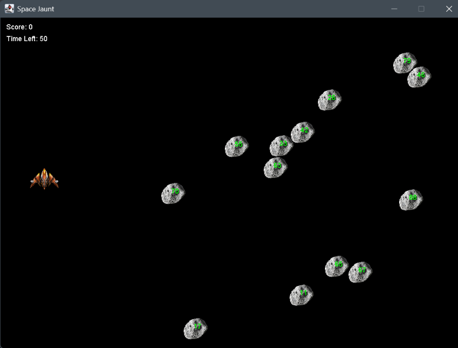

# Space Jaunt

A small 2D arcade game written in **Java (Swing)**. You pilot a spaceship through a field of incoming meteors for 60 seconds and try to collect as many points as you can.



## Gameplay

- The spaceship sits on the left side of the screen and moves **up and down**.
- Meteors spawn at random heights on the right and drift to the left. Each meteor shows a number between 10 and 99.
- Touching a meteor gives you **+10 points** and removes it. What it does to your ship depends on its number:
  - the **tens digit matches the ship's target digit (5)** → ship speed **increases**
  - any other number → ship speed **decreases** (never below a minimum)
- The round lasts **60 seconds**. When time runs out, a dialog shows your final score.

### Controls

| Key | Action |
|-----|--------|
| ↑   | Move up |
| ↓   | Move down |

## Tech stack

- Java (developed with JDK 22, no features newer than Java 8 are required)
- Swing / AWT for the window, rendering and input
- `javax.swing.Timer` for the game loop (~30 ms per frame)

## Getting started

### Requirements

- JDK 17 or newer

### Run from the command line

```bash
git clone https://github.com/<your-username>/<repo-name>.git
cd <repo-name>/src
javac *.java
java Game
```

### Run from an IDE

Open the project in IntelliJ IDEA (or any Java IDE), mark `src` as the sources root and run the `Game` class.

## Project structure

```
src/
├── Game.java            # Entry point, creates the window
├── GamePanel.java       # Game loop, input, collisions, rendering, countdown
├── Spaceship.java       # Player ship: movement, speed, bounds
├── Meteor.java          # Meteor: movement, random value, bounds
├── spaceship.png, meteor.png, space.jpg   # Assets
│
├── GameConfig.java      # Singleton
├── MeteorFactory.java   # Factory
├── MeteorPrototype.java # Prototype
├── LevelBuilder (in Level.java)   # Builder
├── Score.java           # Observer (Score / ScoreObserver)
├── UIFactory.java, GameUIFactory.java, WindowsUIFactory.java, ...  # Abstract Factory (UI widgets)
└── Test/                # Unit test sketches (currently disabled)
```

## Design patterns

Besides the playable core (`Game`, `GamePanel`, `Spaceship`, `Meteor`), the repository contains small implementations of classic design patterns: **Singleton, Factory, Abstract Factory, Builder, Prototype and Observer**. They were written as practice and are **not yet wired into the game loop**; the game itself is driven directly by `GamePanel`.

## Known limitations / possible improvements

- The pattern classes above are standalone and not integrated into the gameplay.
- Collision handling and the countdown timer are simple: the timer runs on its own thread and updates state outside the Swing event thread, and the collision loop removes items from a list while iterating it. Both should be refactored.
- Meteors that leave the screen are never removed from the list.
- The unit tests in `src/Test/` are commented out and need to be updated to match the current classes.
- No build tool (Maven/Gradle) yet; the project is compiled directly with `javac`.
